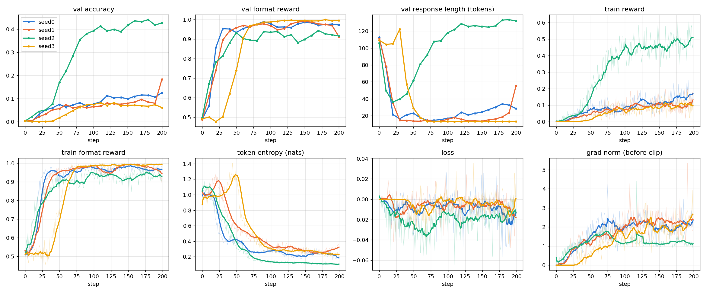
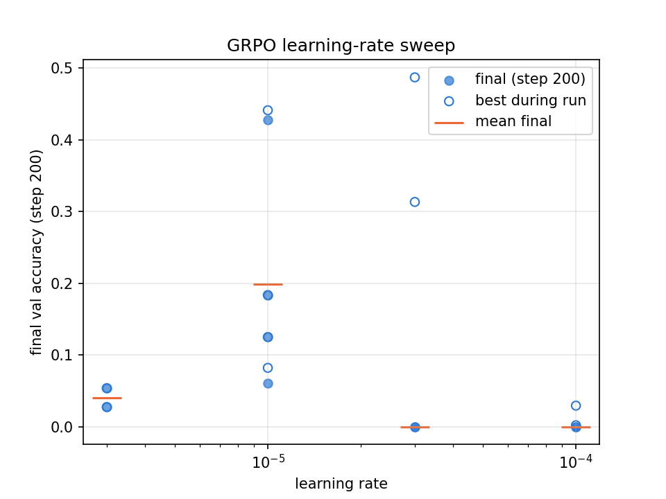
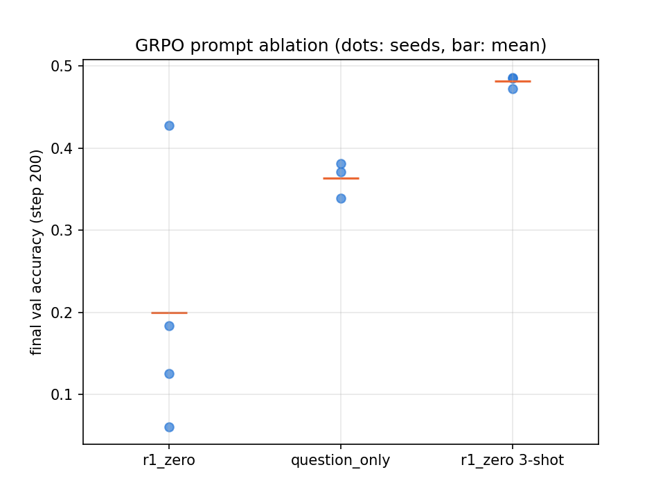

# GRPO from scratch on GSM8K

Reinforcement learning with verifiable rewards, written function by function: a 1B base model
(OLMo-2-0425-1B) learns to solve grade-school math problems from nothing but a 0/1 grader on its
final answer. Follows the structure of Stanford's CS336 post-training assignment, done as a
self-study project.

Plan: prompting baselines → GRPO → RL variants (RFT, Dr. GRPO, MaxRL) → off-policy GRPO with
clipping → (later) instruction-tuning SFT and DPO.

Compute: UF HiPerGator (B200 / RTX PRO 6000); one GPU for the baselines, two for GRPO training.

## Results so far

### GRPO (standard, on-policy)

OLMo-2-0425-1B on GSM8K with the r1_zero prompt, handout hyperparameters (lr 1e-5, 200 steps,
32 questions × 8 rollouts per step, gradient clipping 1.0). Validation on 1024 GSM8K test questions.

| seed | final val accuracy | best (step) | final response length (tokens) |
|---|---|---|---|
| 0 | 12.5 % | 12.5 % (200) | 28 |
| 1 | 18.4 % | 18.4 % (200) | 55 |
| 2 | **42.8 %** | 44.1 % (180) | 132 |
| 3 | 6.1 % | 8.2 % (130) | 13 |
| **mean ± sd** | **19.9 ± 16.0 %** | | |

Starting point: 0.1 % (r1_zero baseline below). An earlier run with seed 0 and the same code reached 39.8 %.



What the curves show:

- **Two phases.** In the first ~50 steps every run learns the answer format (format reward 0.5 → 0.95)
  and its responses collapse from ~110 to 13–36 tokens: `<think> 16 </think> <answer> 24 </answer>` —
  skip the reasoning, guess a number. Accuracy plateaus near 7 %. Some runs then *escape*: response
  length and accuracy rise together as longer reasoning starts to earn reward.
- **Escape timing is the variance.** Seed 2 escaped at ~step 40, the earlier seed-0 run at ~120, seed 1
  is just starting at 200, seeds 0 and 3 never do within 200 steps. The earlier run and seed 0 saw the
  same questions in the same order (same `random.seed`) yet ended at 40 % vs 12 % — the spread comes from
  rollout sampling, amplified by the RL feedback loop.
- **Depth of the collapse predicts the outcome**: minimum length ~36 tokens → best run; 13 → stuck.
- Entropy falls from ~1.0 to 0.1–0.3 nats per token; low entropy alone is not failure (the best run has the lowest).
- Likely cause of the short-answer pull: the per-sequence 1/|o| normalization gives a short correct
  answer a larger per-token update — the length bias Dr. GRPO removes (next experiment).

The handout target (≥ 25 % averaged over seeds) is not met at 200 steps. With the 3-shot prompt it is (48 %, below).

### Learning-rate sweep (r1_zero, 2 seeds per rate; 1e-5 = the 4 seeds above)

| learning rate | final val accuracy | best during run | behaviour |
|---|---|---|---|
| 3e-6 | 2.7 %, 5.4 % | same | too slow — still learning the format at step 200 |
| **1e-5** | 6–43 % (mean 19.9 %) | 44 % | stable, high seed variance |
| 3e-5 | 0 %, 0 % | 31 %, **49 %** | learns fastest, then collapses (gibberish / format drift) |
| 1e-4 | 0 %, 0 % | 3 % | diverges within 30 steps (repetition, no reward) |



Collapse is an absorbing state: `r1_zero_reward_fn` requires the exact string `</think> <answer>`.
At lr 3e-5 one run still answers correctly at the end but writes `</think>\n\n <answer>` — every rollout
scores 0, every group advantage is 0, the gradient is exactly 0, and nothing can pull the policy back.
For a fixed 200-step budget 1e-5 is best; 3e-5 would need early stopping or a decaying rate.
Curves: [`results/grpo_lr_curves.png`](results/grpo_lr_curves.png).

### Prompt ablation (lr 1e-5)

| prompt | seeds | step 0 | final val accuracy | mean ± sd |
|---|---|---|---|---|
| r1_zero | 4 | 0 % | 6, 18, 13, 43 % | 19.9 ± 16.0 % |
| question_only | 3 | 0 % | 37, 34, 38 % | 36.4 ± 2.2 % |
| **r1_zero, 3-shot** | 3 | 21 % | 47, 49, 49 % | **48.1 ± 0.8 %** |



- **3-shot is best and nearly deterministic.** The worked examples teach the format *and* show reasoning,
  so there is no short-answer phase: length stays ~125 tokens, accuracy climbs 21 → 45 % in 40 steps and plateaus.
- **question_only** has no tags to shortcut, so no length collapse (150–280 tokens); entropy starts high (~2.2 nats)
  and falls slowly; all seeds learn, from step ~75–100. (Graded with `question_only_reward_fn`, which accepts any
  extractable answer — accuracy is comparable across prompts, format reward is not.)
- **r1_zero** alone gives the model a format it can satisfy by guessing — the cause of the collapse and the variance.

Curves: [`results/grpo_prompt_curves.png`](results/grpo_prompt_curves.png).

### Supplement: zero-shot Llama 3.1 8B (instruction tuning / safety track)

The A5 supplement moves from reasoning RL to instruction tuning: measure the **base** Llama 3.1 8B
zero-shot, then SFT and DPO it. First benchmark: MMLU (14,042 test questions, 57 subjects).

- Prompt: the MMLU task prompt ("Respond with … 'The correct answer is _'") placed inside a generic
  zero-shot system prompt that frames the text as an assistant conversation (`# Query:` / `# Answer:`);
  greedy decoding, 128 tokens max, stop at the next `# Query:`.
- Scoring: `mmlu.py` parses the reply into a letter. It is deliberately strict — the text after "The correct answer is", up to the first period, must
  be a single option letter (or "(B)") — so hedged replies ("B or C") count as failed parses, not as guesses.

| benchmark | accuracy | failed parses | throughput |
|---|---|---|---|
| MMLU (zero-shot, base model) | **57.9 %** (8,138 / 14,042) | 36 (0.26 %) | 164 examples/s (85.6 s, one GPU, greedy) |
| GSM8K (zero-shot, base model; last number in the reply) | — | — | — |

Meta reports ~66 % for this model, but 5-shot and scored by comparing the probabilities of A–D;
zero-shot generate-and-parse is the harder setting.

- **Failed parses (36)** cluster in long-passage subjects (US/world/European history, professional law).
  25 answer with the *option text* instead of the letter ("…was universal male suffrage."), 3 give the
  letter in another form ("… is B. the Balkan Question …"), 8 ramble — copy the question, continue the
  passage or write a numbered essay — until the 128-token limit. Mapping option text back to its letter
  would rescue 17 of them as correct (+0.1 %).
- **Wrong answers (5,868)**: the model answers in one line with no reasoning (median reply 30 characters),
  so subjects that need computation are weakest (college / high-school mathematics 32–37 %, abstract
  algebra 34 %) and memorised-knowledge subjects strongest (marketing 83 %, US foreign policy 82 %).
  Moral scenarios is *below* chance (24 %): all 3 moral-scenario questions among 10 random wrong
  answers got "B. Wrong, Not wrong". Negated questions ("EXCEPT", "cannot be", "not a complication") are often answered as if
  un-negated — 3 of the 10. There is a letter bias: B is predicted 31 % of the time vs 25 % in the gold
  answers, and accuracy is 65 % when the answer is B vs 52 % when it is A.

### Prompting baselines

Prompting baselines, OLMo-2-0425-1B, GSM8K test (1319 questions), temperature 1.0, top-p 1.0, max 512 tokens:

| prompt | correct | format ok, wrong | format wrong | accuracy |
|---|---|---|---|---|
| question_only | 3 | 214 | 1102 | 0.2 % |
| r1_zero | 1 | 819 | 499 | 0.1 % |
| r1_zero, 3-shot | 244 | 1007 | 68 | 18.5 % |

The same 3-shot prompt with greedy decoding (first 100 questions) gets 38 % accuracy with 100 % format
compliance, so much of the gap is sampling noise from a small model at temperature 1.0 rather than
missing ability. The r1_zero row (≈0 %) is the starting point GRPO has to improve.

## GRPO status

`grpo.py` holds the training components, each checked against the course's reference tests:

| function | what it does | status |
|---|---|---|
| `tokenize_prompt_and_output` | prompt + response → `input_ids`, shifted `labels`, response mask | done |
| `get_response_log_probs` | per-token log p(label) and entropy from a causal LM | done |
| `compute_rollout_rewards` | grader rewards for a batch of rollouts | done |
| `compute_group_normalized_rewards` | advantages: group mean baseline, std normalizer | done |
| `compute_policy_gradient_loss` | per-token loss `-A · log π` (on-policy) | done |
| `aggregate_loss_across_microbatch` | masked mean over tokens, then over sequences (or / constant) | done |
| `grpo_train_step` | microbatched gradient accumulation, grad clipping, logging | done |
| training loop (`grpo_train.py`) | vLLM rollouts + weight sync, validation every 10 steps, JSON-lines log | done — 4 seeds run |

## Layout

| file | what |
|---|---|
| `grpo.py` | the GRPO components (table above) |
| `grpo_train.py` | GRPO training loop: policy on GPU 0, vLLM on GPU 1; `python grpo_train.py <seed> [lr] [prompt]` → `results/grpo_seed<seed>.jsonl` (default) or `results/grpo_<prompt>_lr<lr>_seed<seed>.jsonl` (+ `_rollouts.jsonl`) |
| `run_seeds.sh` | submit the 4-seed runs (seeds 0–3) |
| `run_lr.sh`, `plot_lr.py` | learning-rate sweep (3e-6, 3e-5, 1e-4 × 2 seeds) → final val accuracy vs lr |
| `run_prompts.sh`, `plot_prompts.py` | prompt ablation: question_only and r1_zero 3-shot × 3 seeds → final accuracy per prompt |
| `plot_grpo.py` | train / val reward and format reward vs step from one run log |
| `plot_seeds.py` | 8 metrics (val/train reward, format, length, entropy, loss, grad norm) for several runs: `python plot_seeds.py [out.png] <logs>` |
| `prompting_baselines.py` | generate answers for the three prompts (GPU) → `results/<prompt>.jsonl` |
| `grade_baselines.py` | grade with the Dr. GRPO grader, count categories → `results/<prompt>.graded.jsonl` |
| `inspect_baselines.py` | print random category-2 / category-3 examples for reading |
| `check_greedy.py` | greedy 3-shot sanity check on 100 questions |
| `mmlu.py` | parse an MMLU reply into the answer letter (strict: "The correct answer is B" → B; anything else in that sentence → None) |
| `gsm8k.py`, `gsm8k_baseline.py` | GSM8K parser (last number in the reply) and zero-shot script, same pipeline as MMLU, 512 tokens → `results/gsm8k_baseline.jsonl` |
| `mmlu_baseline.py` | zero-shot MMLU for Llama 3.1 8B: load → prompt → greedy vLLM → parse → `results/mmlu_baseline.jsonl` |
| `run_gpu.sh` | Slurm job: `sbatch run_gpu.sh <script.py> [args]` |
| `push.sh`, `pull.sh` | copy files Mac ↔ HiPerGator |
| `drgrpo_grader.py`, `vllm_utils.py`, `checkpoint.py`, `prompts/`, `prompts_safety/` | grader, vLLM server + weight sync, model loading, prompts — course starter code, unchanged |
| `data/gsm8k/`, `data/mmlu/test/` | GSM8K train / test; MMLU test (57 subject CSVs) |
| `results/*.graded.jsonl` | the graded baseline outputs behind the baseline table |
| `results/grpo_seed*.jsonl` | GRPO run logs (one line per step) and rollout samples (`_rollouts.jsonl`, every 40 steps) |

## Run

```
uv sync --extra gpu                          # on a GPU node, once
sbatch run_gpu.sh prompting_baselines.py     # generation (GPU)
uv run python grade_baselines.py             # grading (no GPU)
./run_seeds.sh                               # GRPO, 4 seeds (2 GPUs each)
python plot_seeds.py                         # plots from results/grpo_seed0..3.jsonl
./run_lr.sh && ./run_prompts.sh              # learning-rate sweep, prompt ablation
sbatch run_gpu.sh mmlu_baseline.py           # zero-shot MMLU, Llama 3.1 8B (needs HF_TOKEN + Meta licence)
sbatch run_gpu.sh gsm8k_baseline.py          # zero-shot GSM8K, same model
```

## Credits

Grader, vLLM utilities, prompts and data come from
[stanford-cs336/assignment5-alignment](https://github.com/stanford-cs336/assignment5-alignment).
